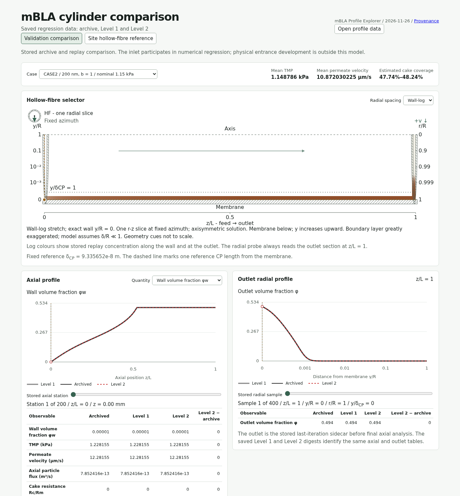
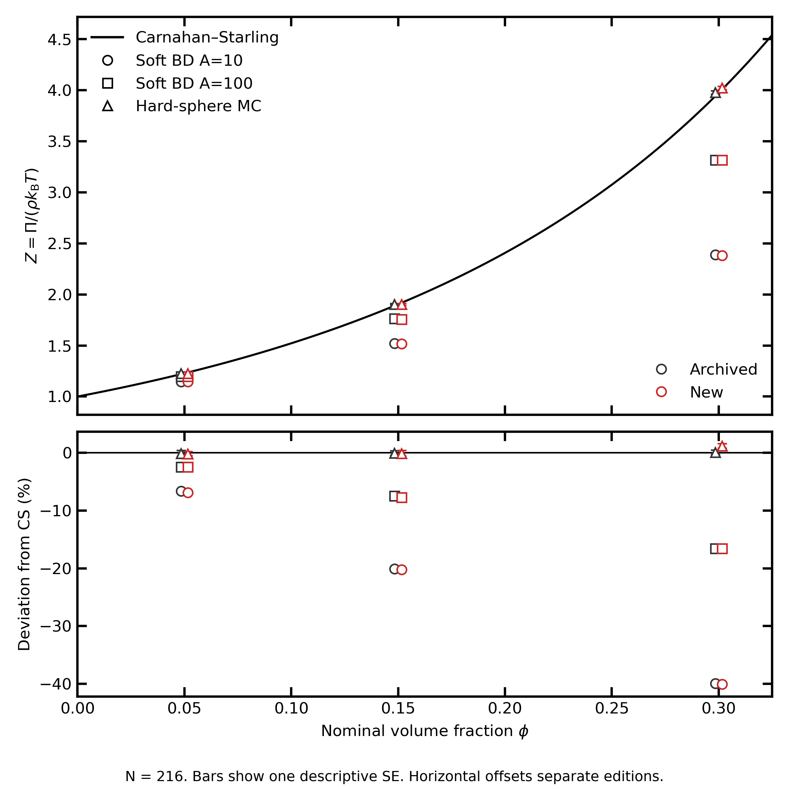

# wb-templates

[AI-generated text](#ki-einsatz-bei-der-dokumentation)

[Interaktive mBLA-Validierung öffnen](wb-mbla/modern-lv2/tools/profile-explorer.html)

Wiederverwendbare wissenschaftliche Vorlagen aus **Agentic Workbench (wb)**.
Kopieren Sie ein kleines, lauffähiges Paket mit seinen Annahmen, Beispielen,
Tests und Herkunftsnachweisen und passen Sie es an Ihre Fragestellung an.

[English](README.md) / [Deutsch](README.de.md) / [한국어](README.ko.md) /
[Katalog](templates.json) / [Regeln zum Kopieren](PACKAGING.org) /
[Lizenzumfang](LICENSE_SCOPE.md)

[Dokumentation](documentation/README.md) /
[Handbuch (Englisch)](documentation/collection-guide/_guide.md) /
[Vorschau: Bericht und Python-Handbuch (Englisch)](documentation/README.md#documentation-families)

Das [Quarto-Vergleichsbeispiel](documentation/examples/quarto-comparison/README.md)
enthält ein kopierbares Projekt für einen Bericht und eine Präsentation zu
Ihrer eigenen Analyse.

Die projekteigenen Grafikstile und ihre Anpassungen fallen unter die MIT-Lizenz
der Sammlung. Für Matplotlib und cmcrameri gelten ihre jeweiligen Lizenzbedingungen.

## Kombinierbare Bausteine für Mehrskalensimulationen

Diese unabhängigen Vorlagen helfen, Berechnungen vorzubereiten, Ausgaben
einzulesen und Ergebnisse darzustellen. Eine Partikelsimulation kann etwa eine
Tabelle geprüfter Transporteigenschaften einschließlich Einheiten und
Gültigkeitsbereich der Konzentration liefern. Ein Kontinuumslöser kann einen
interpolierten Wert aus der Tabelle übernehmen. Eine Grafikvorlage kann
anschließend beide Datensätze im selben Stil darstellen.

- **Level 1 Modernization** erhält eine lauffähige Referenz und dokumentiert ihre Schnittstellen und Architektur.
- **Level 2 Modernization** erhält die numerische Architektur und prüft geänderte Verarbeitungsschritte und beibehaltene Ausgaben.
- **Level 3 Modernization** soll die Kombination wissenschaftlicher Bausteine
  in Mehrskalensimulationen ermöglichen und prüft, ob unabhängige Komponenten
  eine definierte physikalische Größe austauschen können.

In einem internen Projekt mit BD–MC und mBLA wurden Transporteigenschaften
bereits zur Laufzeit berechnet. Der praktische Ablauf interpoliert eine
Tabelle vorberechneter Eigenschaften, um die Auswertung zu beschleunigen.
Die Berechnung zur Laufzeit wird auf Bedingungen ausgeweitet, die eine neue
Berechnung der Eigenschaft erfordern. Ein künftiges Ersatzmodell auf Basis
maschinellen Lernens könnte nach Validierung in seinem Gültigkeitsbereich
dieselbe Schnittstelle verwenden.

Das Plugin Scientific Modernization aus der ergänzenden Sammlung wb-plugins
beschreibt den Ablauf. Eine gemeinsame Validierungsschicht für Druck,
Diffusivität und Spannung in weicher Materie ist geplant. Ob ein bestimmtes
Ergebnis verwendbar ist, ergibt sich aus den Prüfbelegen der jeweiligen Vorlage.

## Mit einer Aufgabe beginnen

- **Ein wissenschaftliches Ergebnis prüfen.** Öffnen Sie den [mBLA Profile Explorer](wb-mbla/modern-lv2/tools/profile-explorer.html) und vergleichen Sie Archiv und Nachrechnung in beiden Schnitten. **Site hollow-fibre reference** zeigt gespeicherte Konzentrations- und Strömungsprofile durch einen gewählten Punkt.
- **Einen älteren Löser wieder in Betrieb nehmen.** Folgen Sie der [BD–MC-Anleitung zu Build und Verifikation](wb-bd-mc/docs/BUILD_AND_USAGE.md), um eine erhaltene Rechnung vor Änderungen auszuführen.
- **Eine Partikelsimulation mit einer Zustandsgleichung vergleichen.** Das
  [BD–MC-Beispiel zur Carnahan–Starling-Zustandsgleichung](examples/bdmc-eos/README.md)
  enthält die gespeicherten Ergebnisse von BD mit weicher Abstoßung und
  Hartkugel-MC samt Abbildungen und Angaben zur Stichprobe.
- **Einen Vergleich darstellen.** Erzeugen Sie mit dem [CSV-Grafikbeispiel](#grafikbeispiel-ausprobieren) PNG- und PDF-Dateien. Das Quarto-Beispiel zeigt, wie Sie die Methoden und Prüfbelege dokumentieren können.

Die [Funktionsreferenz](documentation/collection-guide/_reference.md)
verweist für jeden Bereich auf Implementierung, Konfiguration, Eingaben und Prüfungen.

Die [Vorlage für die wb-python-Schnittstelle](wb-python/README.md)
unterstützt den skriptgesteuerten Umgang mit Session Profiles und Agent Profiles
in künftigen wb-applications-Erweiterungen. Eine eigenständige
Veröffentlichung der Laufzeitkomponente ist vorgesehen. Diese Sammlung enthält
das Handbuch und das Beispiel. Für die Ausführung sind eine konfigurierte
Sandbox und die separat bereitgestellte Laufzeitkomponente erforderlich.
Die Jupyter-Integration bleibt ein
separates Paket in wb-applications. Der Host-Client `wb-client` ist ein
eigenständiges Projekt.

## Validierungsbeispiele



mBLA-Regressionsvergleich. Der gespeicherte Referenzfall CASE2 verwendet einen nominalen TMP von 1,15 kPa und b = 1. [mBLA-Profile öffnen](wb-mbla/modern-lv2/tools/profile-explorer.html)



Vergleich der Gleichgewichtszustandsgleichung. Gezeigt sind ursprüngliche und wiederholte LAMMPS-BD-Läufe mit weichem Kosinuspotential sowie native Metropolis-MC-Läufe mit harten Kugeln, jeweils im Vergleich zu Carnahan–Starling. [Beispiel zur Zustandsgleichung](examples/bdmc-eos/README.md)

## Vorlagen

| Vorlage | Einstieg | Prüfumfang und Grenzen |
|---|---|---|
| [Grafikstile](plot-styles/README.md) | Ein persönlicher Matplotlib-Stil, Farb- und Schwarzweißmodus, Layouts und Legenden | Darstellung und synthetische Beispiele. MIT-Lizenz der Sammlung und Hinweise zu übernommenen Bestandteilen. |
| [wb-style](wb-style/README.md) | Skriptstil des Forschers und neutrales synthetisches CSV-Beispiel | Importieren Sie `wb_style`. MIT-Lizenz der Sammlung und Hinweise zu übernommenen Bestandteilen. |
| [CSV-Datenein- und -ausgabe](scientific-io/README.md) | Gezielte Spaltenauswahl und Prüfung auf endliche Zahlenwerte | CSV-Prüfung anhand der Kopfzeile und explizite Auswahl numerischer Daten. |
| [Quarto-Dokumentation](documentation/examples/quarto-comparison/README.md) | Durchgehender Bericht, Präsentation und Anleitung zum Bearbeiten der Quellen | Vergleiche mit synthetischen Daten für physikalische Größen und deren Quellen, mit lokalen Build-Eingaben. |
| [wb-bd-mc](wb-bd-mc/README.md) | Beispiel für wissenschaftliche Modernisierung mit C++17 und Python | Ausgewählte Prüfungen des ursprünglichen Verhaltens. Die wissenschaftliche Validierung von RPY, SD und Nachbearbeitung steht aus. |
| [wb-python](wb-python/README.md) | Python-Skripte für Session Profiles, bestehende Anfragen und Agent Profiles | Vollständige Anleitung, API, Remote-Schnittstelle und Prüfnachweise auf Englisch. |
| [wb-mbla](wb-mbla/README.md) | Löserpakete für Level 1 und 2, eine Transportschnittstelle für Level 3, eine Filterkuchensuche mit Python/Numba und ein [Offline Profile Explorer](wb-mbla/modern-lv2/tools/profile-explorer.html) | Der Explorer öffnet den dokumentierten Referenzvergleich mit allen acht vollständigen Fällen und drei Übersichten zur Abdeckung. Siehe [Anleitung zum Profile Explorer](wb-mbla/modern-lv2/docs/PROFILE_EXPLORER.md). |

[BD–MC Modernization Levels 1–3](wb-bd-mc/docs/MODERNIZATION_LEVELS.org) erläutert
die erhaltene Regression, die aktuellen Löserkomponenten und den abgegrenzten
Austausch physikalischer Größen in Level 3. Die [Anleitung zur Hydrodynamik](wb-bd-mc/docs/HI_SD.md)
beschreibt RPY und SD sowie die noch offene wissenschaftliche Validierung.

Der [mBLA-Modernisierungsüberblick](wb-mbla/docs/MODERNIZATION.md) erläutert
die JCP-Referenz von 2026, die Filterkuchensuche mit Python/Numba und die geprüfte
Transportschnittstelle für Level 3. Der [interaktive Profile Explorer](wb-mbla/modern-lv2/tools/profile-explorer.html)
öffnet den [eingebetteten Referenzvergleich](wb-mbla/modern-lv2/docs/PROFILE_EXPLORER.md#load-the-recorded-cylinder-regression)
ab CASE2 (`b = 1`, nominaler TMP 1,15 kPa). Beide Profile bleiben sichtbar.
Wählen Sie aus 200 Axialpositionen oder 400 radialen Punkten am Auslass.
Die radiale Anzeige gibt `y/R`, `r/R` und `y/δ_CP` an. Das Level-3-Beispiel
benötigt den Level-2-Löser aus demselben mBLA-Paket.

## HTML-Dokumentation erstellen

Die [Dokumentationsübersicht](documentation/README.md) verlinkt auf die
Markdown- und Org-Quellen. Installieren Sie Python 3.10 oder neuer und
Quarto 1.8.26. Führen Sie im Wurzelverzeichnis der Sammlung in einer
POSIX-Shell diese Befehle aus:

```sh
site="$(mktemp -d)/wb-templates-site"
python3 -B tools/build_html.py --quarto "$(command -v quarto)" --output "$site"
python3 -m http.server --bind 127.0.0.1 --directory "$site" 8765
```

Öffnen Sie <http://127.0.0.1:8765/>, solange der Server läuft. Das separate
Ausgabeverzeichnis enthält die gerenderten Seiten, das Handbuch, die
Python-Vorschau und die mitgelieferten Werkzeuge, Folien und Daten.
Der Build liest die aktuellen Inhalte der Dateien im Distributionsmanifest.
[Anleitung für den Quarto-Bericht und die Reveal.js-Folien](documentation/examples/quarto-comparison/README.md#render-the-example) (Englisch).

## Grafikbeispiel ausprobieren

Sie benötigen Python 3.10 oder neuer und die angegebenen Abhängigkeiten des
jeweiligen Teilpakets. Führen Sie aus dem Verzeichnis dieser Sammlung in Ihrer
gewählten Python-Umgebung aus.

```sh
python3 -m pip install ./plot-styles ./scientific-io
python3 -B examples/plot_csv.py --output /tmp/my-new-wb-plot
```

Das Beispiel erzeugt eine eigene synthetische CSV-Datei und schreibt PNG, PDF
und Metadaten zur Darstellung in ein neues Verzeichnis. Es startet keinen
wissenschaftlichen Löser. Wählen Sie einen neuen Ausgabepfad, falls das
Verzeichnis bereits existiert. Nach Installation der Grafikpakete können Sie
mit `plot-styles/examples/render_examples.py --output` und einem neuen
Ausgabepfad auch Layouts und Legenden ausprobieren.

```python
import matplotlib.pyplot as plt
from wb_plot_styles import style_context

with style_context(color_mode="monochrome") as rendering:
    fig, ax = plt.subplots(figsize=rendering["defaults"]["figsize"])
    ax.plot([0, 1], [0, 1], marker="o")
    ax.set(xlabel="x (synthetic)", ylabel="y (synthetic)")
    fig.savefig("my-figure.pdf", bbox_inches="tight")
```

Der gemeinsame Stil `personal` bietet die Darstellungsmodi `color`
(Standard mit originaler batlow-Farbreihenfolge) und `monochrome`
(Schwarz mit unterscheidbaren Linienstilen). Geometrie, Textgrößen und
Linienbreiten sind identisch. Die Quellenangaben enthalten Autor und Jahr.
Abweichende Größen lassen sich für ein Projekt gezielt einstellen.

## Kopieren, prüfen und anpassen

```sh
python3 tools/verify_manifest.py
python3 tools/export_template.py --template plot-styles --destination /tmp/my-new-plot-styles
```

Eine eigenständige Kopie enthält ihre Lizenz, Hinweise, Tests und
Herkunftsnachweise. Installieren Sie die angegebenen Abhängigkeiten des
gewählten Teilpakets separat. Wählen Sie ein neues Zielverzeichnis. Das
Kopierwerkzeug akzeptiert reguläre Quelldateien.

[Validierung und Reproduktion](provenance/VALIDATION.org) beschreibt das
geprüfte Verhalten und die Befehle zur Wiederholung. Führen Sie die
dokumentierten Tests des gewählten Teilpakets aus. Ein Smoke-Test, eine
Regression, eine physikalische Konsistenzprüfung und eine wissenschaftliche
Abnahme erfassen jeweils unterschiedliche Aspekte. Schriftarten und TeX
können abweichen, daher kann sich die Darstellung von veröffentlichten
Abbildungen unterscheiden. Die Darstellungsstile arbeiten mit den bereitgestellten
Daten. Einheiten, Datentransformationen, Modellwahl und Löservalidierung
liegen bei der Analyse.

Org-Dateien sind Klartext. Die Markdown-Überschriften `#` und `##` entsprechen
`*` und `**` in Org. `[[file:path][label]]` bezeichnet einen lokalen Link.
Die Sammlung bietet diese Einstiegsseite auf Englisch, Deutsch und Koreanisch.
Die technische Dokumentation ist auf Englisch.

## Namensnennung und Lizenz

Erhalten Sie Gunwoo Parks ursprüngliche Autorschaft, die Namensnennung Dritter und die
[wissenschaftlichen und Software-Quellenangaben](CITATION.cff). Den Umfang
der jeweiligen Prüfungen beschreibt die [Validierungsanleitung](provenance/VALIDATION.org).
Die Projektleitung, durchgeführte Prüfungen und eine menschliche Begutachtung
werden gesondert ausgewiesen. Die [MIT-Lizenz](LICENSE) der Sammlung gilt für
neue, gemeinsam genutzte Bestandteile mit den [Ausnahmen der Teilpakete](LICENSE_SCOPE.md).
Das aus Apache-lizenzierten Quellen abgeleitete HI-Material behält seine
Lizenz und NOTICE. Für separat installierte Abhängigkeiten gelten deren eigene
Bedingungen. Die Quellpakete enthalten weder Binärdateien der Abhängigkeiten
noch separate Schriftpakete. Gerenderte Dokumente können Teile einer Schriftart
einbetten. Für den Grafik-Quellcode gelten die MIT-Lizenz der Sammlung und die
jeweils einschlägigen Hinweise der ursprünglichen Quellen.

## Grafikstil und Farbreferenzen

Gunwoo Park schrieb die ursprünglichen Skripte und den Stil für die Abbildungen
seiner Publikationen. Die Beispiele verwenden eigenständige synthetische Daten
mit eigenen Dateinamen, Schemata und Ergebnissen.
Die [Quellen zum Stil, den Publikationen und batlow](wb-style/REFERENCES.md) und
der [MIT-Lizenzhinweis für cmcrameri 1.10](plot-styles/THIRD_PARTY_NOTICES/cmcrameri-1.10-LICENSE.txt)
dokumentieren die jeweiligen Ursprünge.

## Autor und Projektinformationen

**Autor und Projektleiter (Project Director):** Gunwoo Park.
[Zitationsmetadaten](CITATION.cff)

Projektübersicht: <https://github.com/gwpark-git/agentic-workbench-knowledge>  
Repository für wb-templates (geplant): <https://github.com/gwpark-git/wb-templates>

### KI-Einsatz bei der Dokumentation

OpenAI Codex unterstützte unter Leitung von Gunwoo Park den Entwurf, die
Überarbeitung und die Übersetzung der Dokumentation.
[Herkunftsnachweis der Dokumentation](provenance/DOCUMENTATION_PROVENANCE.json)
