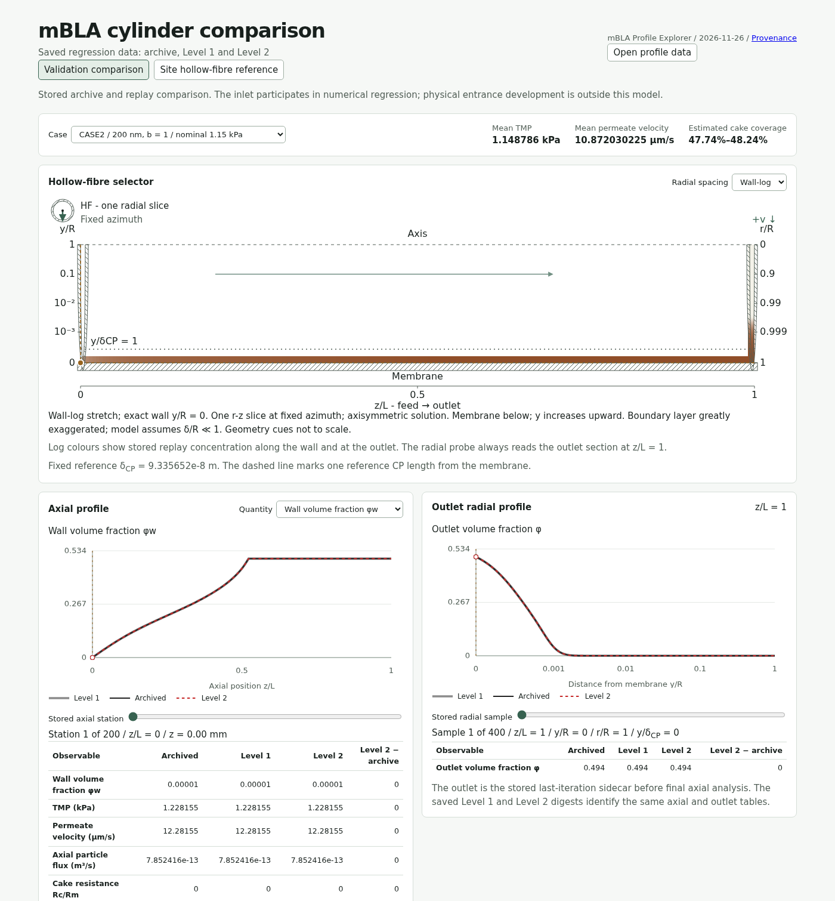
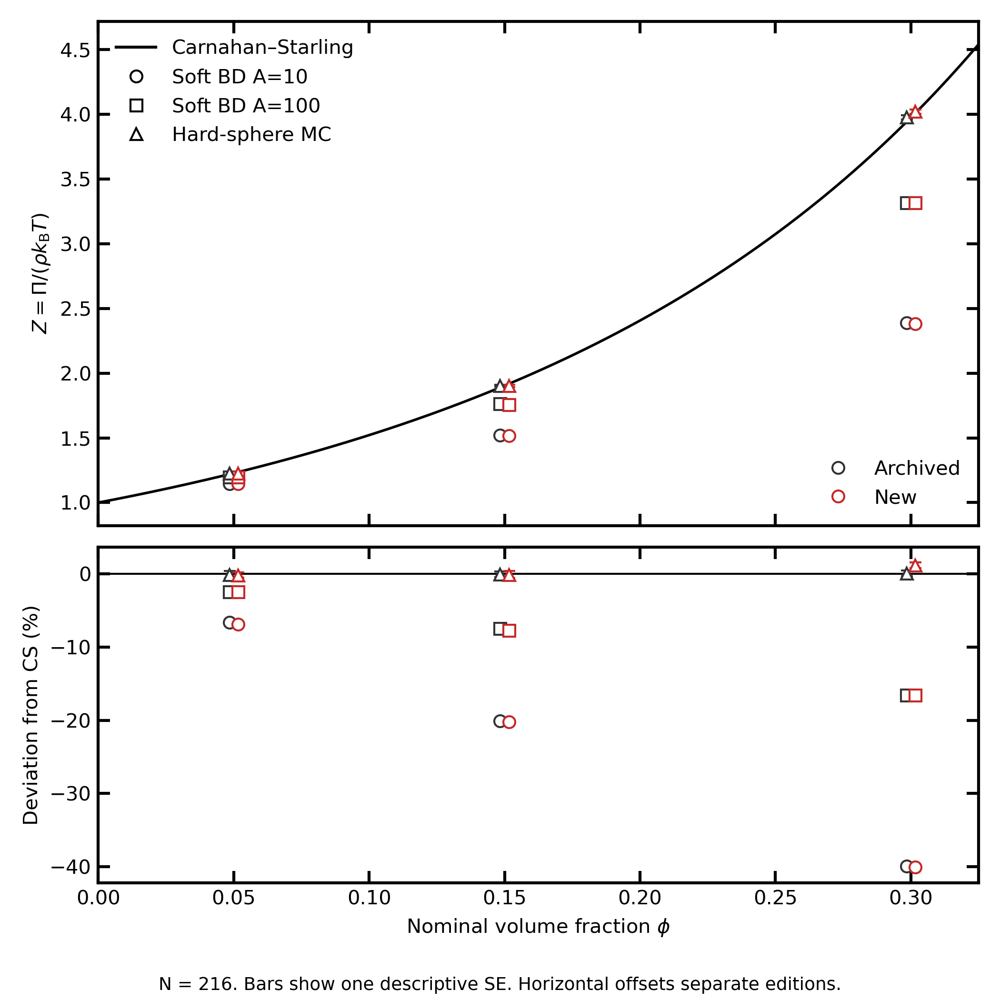

# wb-templates

[AI-generated text](#ai-assistance)

[mBLA 대화형 검증 열기 (영어)](wb-mbla/modern-lv2/tools/profile-explorer.html)

**Agentic Workbench(wb)**의 재사용 과학 템플릿입니다.
전제, 예제, 테스트, 출처를 갖춘 작은 과학 도구를 복사한 뒤,
자신의 문제에 맞춰 사용합니다.

[English](README.md) / [Deutsch](README.de.md) / [목록](templates.json) / [복사 계약 — 영어](PACKAGING.org) /
[라이선스 범위 — 영어](LICENSE_SCOPE.md)

[문서 목차 — 영어](documentation/README.md) /
[상세 HTML 가이드 — 영어](documentation/collection-guide/report.html) /
[보고서·Python 가이드 미리보기 — 영어](documentation/README.md#documentation-families)

프로젝트가 소유한 플롯 스타일과 재사용 코드는
컬렉션 MIT를 적용합니다. Matplotlib과 cmcrameri에는 각각의 조건이 적용됩니다.

## 다중스케일 모사를 위한 과학적 조합 가능성

각 프리셋은 과학 계산, 결과 읽기, 시각화를 지원합니다. 예를 들어 입자
모사에서 검증한 수송 물성을 단위와 적용 농도 범위와 함께 표로 정리하고,
보간값을 연속체 solver에 줄 수 있습니다. 플롯 프리셋으로 두 결과에 같은
스타일을 적용할 수도 있습니다.

- **Level 1 Modernization**은 작동하는 기준선을 보존하고 인터페이스와 아키텍처를 분석합니다.
- **Level 2 Modernization**은 수치 아키텍처를 유지하며 변경 연산과 출력을 비교합니다.
- **Level 3 Modernization**은 다중스케일 모사의 과학적 조합 가능성을 목표로 합니다.
  독립 패키지가 정의된 물리량을 주고받는지 실제로 검사합니다.

내부 프로젝트에서는 BD–MC와 mBLA를 연결해 수송 물성을 직접 계산하는 live coupling을
검사했습니다. 보통은 미리 계산한 물성표를 보간해 계산 시간을 줄입니다.
새 물성값을 직접 계산해야 하는 조건으로 live coupling을 확장 중이며,
추후 검증한 ML 물성 모델도 같은 인터페이스에 연결할 수 있습니다.

절차는 companion wb-plugins의 wb-scientific-modernization이 관리합니다.
압력, 확산계수, 응력 등 소프트매터 물리량의 공통 검증 계층은 향후 통합할
예정입니다. 구체적인 결과의 사용 범위는 템플릿별 근거를 확인하십시오.

## 작업별 시작점

- **필터 결과 확인.** 탐색기에서 원본과 재계산을 비교하고, **Site hollow-fibre reference**에서 선택 지점의 농도와 속도를 확인합니다. [mBLA 탐색기 — 영어](wb-mbla/modern-lv2/tools/profile-explorer.html)
- **기준 계산 재현.** 저장된 사례를 먼저 실행합니다. [BD–MC 빌드 및 검증 — 영어](wb-bd-mc/docs/BUILD_AND_USAGE.md)
- **결과 그림과 문서 작성.** 예제에서 PNG와 PDF를 생성한 뒤 보고서나 Python 가이드 양식을 복사합니다. [플롯 실행](#플롯-실행) / [문서 양식 — 영어](documentation/README.md#documentation-families)

## 검증 예시



mBLA 회귀 검증. 저장된 CASE2 기준 조건은 공칭 TMP 1.15 kPa, b = 1입니다. [mBLA 프로파일 탐색기](wb-mbla/modern-lv2/tools/profile-explorer.html)



평형 상태방정식 비교. LAMMPS soft-cosine BD와 자체 BD–MC의 hard-sphere Metropolis MC 각각의 원래 계산과 재계산을 Carnahan–Starling과 비교합니다. [EOS 예제](examples/bdmc-eos/README.md)

## 템플릿

| 템플릿 | 사용할 수 있는 출발점 | 검증 범위와 경계 |
|---|---|---|
| [플롯 스타일 — 영어](plot-styles/README.md) | 공통 personal 스타일, 흑백, 컬러 모드, 패널, 범례 예제 | 표현과 합성 예제. 컬렉션 MIT 및 외부 출처 고지. |
| [wb-style — 영어](wb-style/README.md) | 연구자 원본 script 기반 스타일과 중립적인 합성 CSV 예제 | `wb_style` import. 컬렉션 MIT 및 외부 출처 고지. |
| [CSV 데이터 I/O — 영어](scientific-io/README.md) | 명시적 열 선택과 유한 수치 검증 | 헤더를 검사하고 명시한 수치 열을 읽습니다. |
| [Quarto 문서 — 영어](documentation/examples/quarto-comparison/README.md) | 연속형 보고서, 슬라이드 및 소스 편집 안내 | 물리량과 코드 비교 합성 예제 및 로컬 빌드 입력. |
| [wb-bd-mc (영어)](wb-bd-mc/README.md) | C++17/Python 과학 코드 현대화 예제 | 원본 기능 일부를 검사했습니다. RPY, SD, 후처리의 과학적 검증은 남아 있습니다. |
| [wb-python (영어)](wb-python/README.md) | Session Profile, 기존 요청, Agent Profile을 사용하는 Python 스크립트 | 상세 안내서, API, 원격 연동 범위 및 검증 근거. |
| [wb-mbla (영어)](wb-mbla/README.md) | Level 1과 2 솔버, Level 3 수송 인터페이스, Python/Numba 케이크 탐색, [프로파일 탐색기](wb-mbla/modern-lv2/tools/profile-explorer.html) | 탐색기에서 원래 레퍼런스의 전체 비교 8개와 피복률 요약 3개가 열립니다. [데이터 안내](wb-mbla/modern-lv2/docs/PROFILE_EXPLORER.md) |

[BD–MC 현대화 Level 1–3 — 영어](wb-bd-mc/docs/MODERNIZATION_LEVELS.org)에서
기준 회귀 검사, 현재 계산 구성 요소, Level 3 물성 교환의 검증 범위를
확인할 수 있습니다. [HI 안내 — 영어](wb-bd-mc/docs/HI_SD.md)의 RPY와 SD는 과학적
검증이 남아 있습니다.

[mBLA 현대화 개요 — 영어](wb-mbla/docs/MODERNIZATION.md)는 JCP 2026 기준선,
Python/Numba 케이크 탐색과 검증한 Level 3 수송 인터페이스를 설명합니다.
[대화형 프로파일 탐색기 — 영어](wb-mbla/modern-lv2/tools/profile-explorer.html)를 열면
[내장된 원본 회귀 데이터 — 영어](wb-mbla/modern-lv2/docs/PROFILE_EXPLORER.md#load-the-recorded-cylinder-regression)가
CASE2 (`b = 1`, 공칭 TMP 1.15 kPa)에서 바로 열립니다. 축방향 200개 지점과
출구 반경방향 400개 샘플을 함께 보여주며, 반경 선택값에 `y/R`, `r/R`,
`y/δ_CP`가 표시됩니다. Level 3 제공자 예제를 빌드할 때는 같은 mBLA
패키지에 Level 2 솔버를 함께 둡니다.

[wb-python 인터페이스 프리셋 — 영어](wb-python/README.md)는
향후 wb-applications 확장에서 Session Profile과 Agent Profile을 스크립트로
다루는 기본 도구입니다. 이 공개본에는 매뉴얼과 예제 문서가 들어 있습니다.
예제를 실행하려면 설정된 Sandbox와 별도 런타임이 필요합니다. 런타임은
독립 공개를 계획하고 있습니다.
Jupyter 연동은 wb-applications의 별도 패키지이고, Host용 `wb-client`는
독립 프로젝트입니다.

[BD–MC Carnahan–Starling 예제 — 영어](examples/bdmc-eos/README.md)에서 soft-repulsive BD와
hard-sphere MC의 결과 CSV와 PDF, PNG 및 샘플링 범위를 확인할 수 있습니다.

[Quarto 문서 템플릿 — 영어](documentation/examples/quarto-comparison/README.md)는
물리량과 소스코드 비교를 예제로 제공합니다.
[문서 목차 — 영어](documentation/README.md) /
[상세 가이드 — 영어](documentation/collection-guide/report.html).
[기능별 참조 — 영어](documentation/collection-guide/report.html#functional-reference)에는
각 도구의 구현, 설정, 데이터 형식과 검증 문서가 연결되어 있습니다.

## 플롯 실행

Python 3.10+와 각 하위의 명시된 의존성이 필요합니다.
선택한 Python 환경에서 이 컬렉션을 기준으로 실행합니다.

```sh
python3 -m pip install ./plot-styles ./scientific-io
python3 -B examples/plot_csv.py --output /tmp/my-new-wb-plot
```

예제는 합성 CSV를 직접 만들고 새 폴더에 PNG/PDF, 렌더링 메타데이터를 저장합니다.
과학 모사기는 실행하지 않습니다. 출력 폴더가 이미 있으면 다른 새 이름을 선택합니다.
패널, 범례 예제는 플롯 패키지 설치 후 `plot-styles/examples/render_examples.py --output`에
새 경로를 주어 실행합니다.

```python
import matplotlib.pyplot as plt
from wb_plot_styles import style_context

with style_context(color_mode="monochrome") as rendering:
    fig, ax = plt.subplots(figsize=rendering["defaults"]["figsize"])
    ax.plot([0, 1], [0, 1], marker="o")
    ax.set(xlabel="x (synthetic)", ylabel="y (synthetic)")
    fig.savefig("my-figure.pdf", bbox_inches="tight")
```

공통 `personal` 스타일에서 `color`(기본: 실제 batlow 색상) 또는
`monochrome`(검은색과 구별되는 선 종류)을 선택합니다. 그림 크기, 글자, 선 두께는
공유합니다. 저자, 연도 정보는 출처 기록에 보존합니다. 프로젝트별 크기는 표현 override로 명시합니다.

## 복사, 검증, 적용

```sh
python3 tools/verify_manifest.py
python3 tools/export_template.py --template plot-styles --destination /tmp/my-new-plot-styles
```

독립 복사본에도 라이선스, 고지, 테스트, 출처를 보존합니다. 선택한 하위 패키지의
의존성 설치는 별도 단계입니다. 출력은 새 경로여야 하며 링크, 특수 파일은
거부합니다.

[검증 및 재현 — 영어](provenance/VALIDATION.org)에 검사 범위와 실행 명령이 있습니다. 선택한 하위 안내의 테스트를 실행하십시오. 실행 확인, 회귀, 물리적 일관성,
과학적 수용은 다른 근거입니다. 폰트, TeX 환경 차이가 있으며 출판 그림과 픽셀 동일성은
주장하지 않습니다. 스타일은 단위를 추론하거나 데이터를 변환하거나 물리 모델을
선택하거나 모사기를 검증하지 않습니다.

Org는 일반 텍스트입니다. Markdown `#`, `##`는 Org `*`, `**`에
대응하고, `[[file:path][label]]`은 로컬 링크입니다. 하위 기술 문서는 대부분
영어입니다.

## 저자, 라이선스

Gunwoo Park의 원저자 표시, 제3자 고지, [과학, 소프트웨어 인용](CITATION.cff)을
유지하십시오. 과학과 소프트웨어 검사의 범위는 [검증 안내](provenance/VALIDATION.org)에 정리했습니다.

루트 [MIT](LICENSE)는 새 공통 자료에 적용하며 [하위 예외](LICENSE_SCOPE.md)를 따릅니다.
Apache 유래 HI는 라이선스, NOTICE를 보존하고 별도 의존성은 자체 조건을 유지합니다.
소스 패키지에는 의존성 바이너리나 별도 글꼴 패키지가 들어 있지 않습니다.
렌더링한 문서에는 글꼴의 일부가 내장될 수 있습니다. 플롯 소스에는 컬렉션 MIT와
해당 외부 출처 고지를 함께 제공합니다.

영어 안내를 기준으로 작성한 전체 한국어 번역이며 수동으로 관리합니다.

## 플롯 스타일의 원저자와 색상 출처

논문에 사용한 원래 Python plotting script와 스타일은 Gunwoo Park이 작성했습니다. 예제는 논문의 파일명, 스키마, 결과와 관계없는 합성 데이터입니다. [스타일, 논문, batlow 참고자료 — 영어](wb-style/REFERENCES.md)와 [실제 cmcrameri1.10 MIT 고지](plot-styles/THIRD_PARTY_NOTICES/cmcrameri-1.10-LICENSE.txt)를 확인하십시오.

## 저자 및 프로젝트 정보

**저자 및 프로젝트 책임자:** Gunwoo Park. [인용 메타데이터](CITATION.cff)

프로젝트 개요: <https://github.com/gwpark-git/agentic-workbench-knowledge>  
wb-templates 공개 예정 저장소: <https://github.com/gwpark-git/wb-templates>

### AI assistance

OpenAI Codex는 Gunwoo Park의 지휘 아래 문서 초안 작성과 편집을 지원했습니다.
[문서 출처 — 영어](provenance/DOCUMENTATION_PROVENANCE.json)
