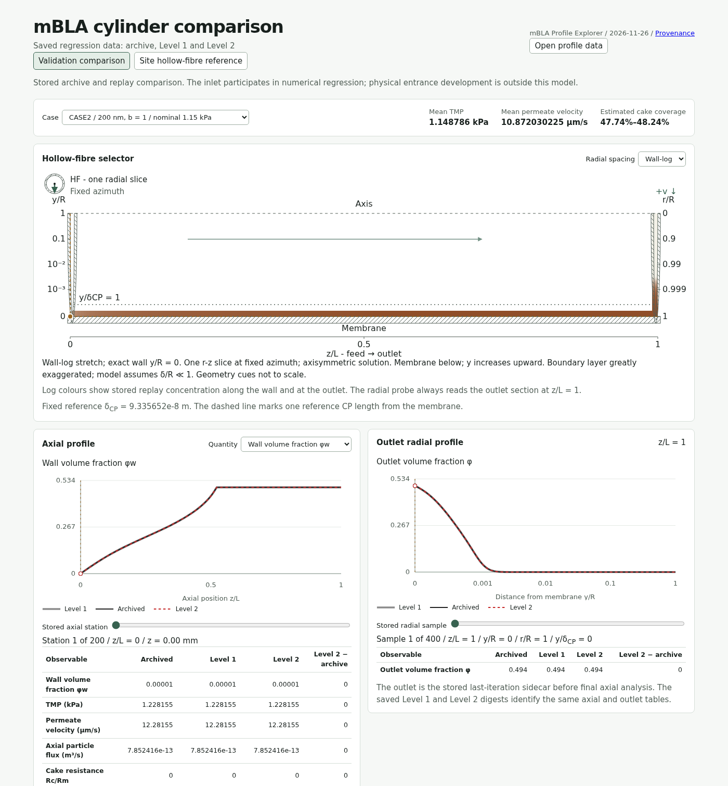
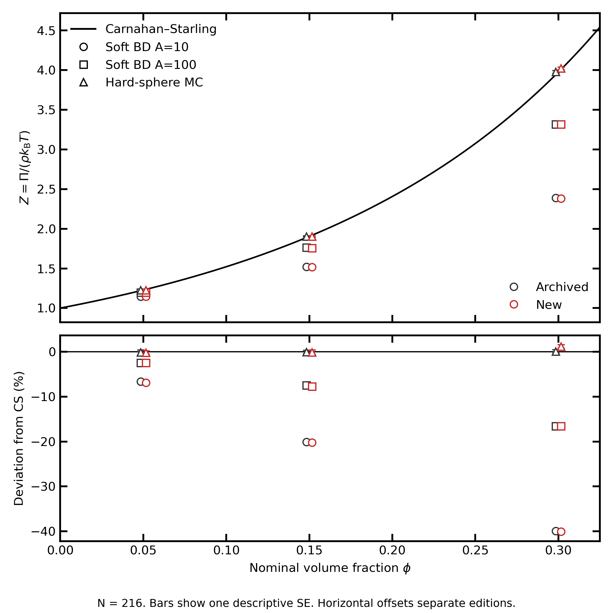

# wb-templates

[AI-generated text](#ai-assistance)

[Open mBLA interactive validation](wb-mbla/modern-lv2/tools/profile-explorer.html)

Reusable scientific templates from **Agentic Workbench (wb)**. Copy a small working scientific kit with its
assumptions, examples, tests and provenance, then adapt it to your problem.

[Deutsch](README.de.md) / [한국어](README.ko.md) / [Catalog](templates.json) / [Copying contract](PACKAGING.org) /
[License scope](LICENSE_SCOPE.md)

[Documentation](documentation/README.md) /
[Collection guide](documentation/collection-guide/_guide.md) /
[Report and Python guide previews](documentation/README.md#documentation-families)

Use the [Quarto comparison example](documentation/examples/quarto-comparison/README.md)
when you want a copyable report and slide project for your own analysis.

Project-owned plotting styles and their
adaptations share the collection MIT grant. Matplotlib and cmcrameri keep
their stated third-party terms.

## Before reading the AI-generated documentation

Here is a brief overview of what wb-templates means to me (I wrote this part myself, while other content is AI-generated). Basically, I wanted to build my own Agentic AI environment to support and accelerate my research activities. This ranges from simplified tests of various modeling techniques to combining different simulations, such as multiscale simulations. Sometimes, I want to use the same interface for simulations at different scales, such as microscopic and macroscopic scales. Sometimes, I want to evaluate physical quantities using my own definitions and analysis styles. Moreover, scientific verification often follows different practices depending on the research field and laboratory.

In this regard, whenever I try to develop a final application, I encounter similar issues with my old code. I need a suitable "development interface" in which individual functionalities can be developed separately, evolve, or become obsolete over time, with only those that survive this process becoming part of the final contribution. In fact, many of the tests themselves are meaningful in establishing appropriate scientific protocols, even though they are not included in the final results.

The current wb-templates are designed to reduce this recurring overhead in establishing development and verification protocols, while providing an efficient starting point for new research activities. Many of the templates are derived from existing open-source codes whose architectures and functionalities may be outdated, but whose underlying physical models are well established.

Thus, using wb-plugins as a methodological foundation, I pursue modernizing existing scientific codes while exploring simpler ways to integrate different physical mechanisms.

In addition, I include a Python interface and other functionalities (e.g., Quarto-based documentation workflows) to reduce repetitive effort across similar tasks.

Gunwoo Park, 26 Nov. 2026


## Before going into AI-generated documents
Here is a brief overview to explain what wb-templates mean for me. Basically, I wanted to build my own Agentic AI environment to boost my research activities. This spans from simplified tests of various modeling techniques to combining different simulations, such as multiscale simulations. Sometimes I want to use the same interface for different scales, such as microscopic and macroscopic scales. Sometimes I want to check some physical quantities with my own styles and definitions. Often, scientific verification follows different customs depending on the field and lab.

In this regard, when I would like to get the final applications, I always face similar issues with my old code. Providing a suitable "development interface" where functionality is partitioned and decayed over time, and only final survival becomes a meaningful contribution. In fact, many of the "tests" themselves are meaningful for reaching the proper protocols, but are not included in the results.

The current wb-templates are designed to reduce this functional overhead on the protocol side, as well as to find an efficient way to start with it. Many templates were inherited from open source, where their architectures and functionalities are outdated, while their physical meanings are proven.

So, based on wb-plugins, I delve into modernization while also integrating with other physical mechanisms in a simplified way. 


## Scientific Composability for Multiscale Simulation

These independent presets help prepare computations, read outputs and present
results. For example, a particle simulation can produce a table of validated
transport properties with units and an applicable concentration range. A
continuum solver can consume an interpolated value from that table. A
plotting preset can then present both datasets in a common style.

- **Level 1 Modernization** preserves a runnable baseline and maps interfaces and architecture.
- **Level 2 Modernization** preserves the numerical architecture and verifies changed operations and retained outputs.
- **Level 3 Modernization** aims at scientific composability for multiscale
  simulation and checks that independent components can exchange a defined
  physical quantity.

An internal BD–MC and mBLA project has exercised live transport-property
evaluation. The practical workflow interpolates a table of precomputed
properties to reduce evaluation time. Live evaluation is being extended to
conditions that need a fresh property calculation. A future ML surrogate
could use the same interface after validation over its applicable range.

The Scientific Modernization plugin in the companion wb-plugins collection
owns the workflow. A shared soft-matter
validation layer for pressure, diffusivity and stress is planned. Use the
template's own evidence when deciding whether a particular result is ready for use.

## Start with a task

- **Inspect a scientific result.** Open the [mBLA regression](wb-mbla/modern-lv2/tools/profile-explorer.html)
  to compare the archive and replays at both stored sections. Select **Site
  hollow-fibre reference** for saved concentration and flow through a probe point.
- **Recover an older solver.** Follow the [BD–MC build and verification guide](wb-bd-mc/docs/BUILD_AND_USAGE.md)
  to run a retained calculation before changing it.
- **Compare a particle simulation with an equation of state.** Open the
  [BD–MC Carnahan–Starling example](examples/bdmc-eos/README.md) for the retained
  soft-repulsive BD and hard-sphere MC results, figures and sampling scope.
- **Present a comparison.** Use the [CSV plotting example](#try-plotting) to generate
  PNG and PDF outputs, then reuse the Quarto example to share methods and evidence.

The [functional reference](documentation/collection-guide/_reference.md)
links implementation, configuration, inputs and checks for each area.

The [wb-python interface preset](wb-python/README.md) supports
scripted use of Session Profiles and Agent Profiles for future
wb-applications integrations. This edition includes the manual and worked
example. A configured Sandbox and separately supplied runtime are required
to run the Python example. A standalone runtime release is planned.
The Jupyter integration remains a separate wb-applications package.
The Host-side `wb-client` has its own project.

## Validation examples



mBLA regression comparison. The saved CASE2 reference uses nominal TMP 1.15 kPa and b = 1. [Open the mBLA profile explorer](wb-mbla/modern-lv2/tools/profile-explorer.html)



Equilibrium equation of state. Original and repeat runs of LAMMPS soft-cosine BD and native hard-sphere Metropolis MC are compared with Carnahan–Starling. [Open the EOS example](examples/bdmc-eos/README.md)

## Templates

| Template | Useful starting point | Checked scope / boundary |
|---|---|---|
| [Plot styles](plot-styles/README.md) | One personal Matplotlib style, color/monochrome modes, layouts and legends | Appearance and synthetic examples. Collection MIT and upstream notices. |
| [wb-style](wb-style/README.md) | Researcher-authored script style, neutral synthetic CSV example | Import `wb_style`. Collection MIT and upstream notices. |
| [CSV data I/O](scientific-io/README.md) | Explicit column selection and finite numeric validation | Header-aware CSV inspection and explicit numeric selection. |
| [Quarto documentation](documentation/examples/quarto-comparison/README.md) | Continuous report, slide deck and source editing guide | Synthetic physical-quantity and source comparisons, with local build inputs. |
| [wb-bd-mc](wb-bd-mc/README.md) | C++17/Python scientific modernization example | Selected checks of original behavior. RPY, SD and post-processing await scientific validation. |
| [wb-python](wb-python/README.md) | Python scripting for Session Profiles, existing requests and Agent Profiles | Reader guide, API and verification reference. Obtain the runtime separately to run the example. |
| [wb-mbla](wb-mbla/README.md) | Level 1 and 2 solver packages, Level 3 transport interface, Python/Numba cake search and [offline profile explorer](wb-mbla/modern-lv2/tools/profile-explorer.html) | The explorer opens the recorded reference comparison, with all eight full cases and three coverage summaries. See the [data guide](wb-mbla/modern-lv2/docs/PROFILE_EXPLORER.md). |

[BD–MC Modernization Levels 1–3](wb-bd-mc/docs/MODERNIZATION_LEVELS.org) covers
the retained regression, current solver components, and bounded Level 3
property exchange. The [hydrodynamics guide](wb-bd-mc/docs/HI_SD.md) describes
RPY and SD, whose scientific validation remains open.

The [mBLA modernization overview](wb-mbla/docs/MODERNIZATION.md) covers the JCP 2026
reference, the Python/Numba cake search, and the tested Level 3 transport
interface. The [interactive profile explorer](wb-mbla/modern-lv2/tools/profile-explorer.html)
opens the [embedded reference regression](wb-mbla/modern-lv2/docs/PROFILE_EXPLORER.md#load-the-recorded-cylinder-regression),
starting at CASE2 (`b = 1`, nominal TMP 1.15 kPa). Both profiles stay visible.
Select from 200 axial stations or 400 samples at the outlet; the radial probe
shows `y/R`, `r/R` and `y/δ_CP`. To build the Level 3 provider example, keep
it with the Level 2 solver in the same mBLA package.

## Build the HTML site

Read the [documentation index](documentation/README.md) on GitHub for the
Markdown and Org guides. To build the complete browser version, install
Python 3.10 or later and Quarto 1.8.26, then run these commands from the
repository root in a POSIX shell:

```sh
site="$(mktemp -d)/wb-templates-site"
python3 -B tools/build_html.py --quarto "$(command -v quarto)" --output "$site"
python3 -m http.server --bind 127.0.0.1 --directory "$site" 8765
```

Open <http://127.0.0.1:8765/> while the server is running. The builder renders
Markdown and Org pages, the collection handbook and the Python guide preview
into a separate directory with the bundled tools, slides and data. It
follows the distribution manifest's file list and reads the current contents
of those files, so you can rebuild after editing a guide. The command runs
no scientific model or documentation code block.

For the standalone Quarto report and Reveal.js deck, see their [render instructions](documentation/examples/quarto-comparison/README.md#render-the-example).

## Try plotting

Python 3.10+ and each child's declared dependencies are required. From this collection, in your chosen environment:

```sh
python3 -m pip install ./plot-styles ./scientific-io
python3 -B examples/plot_csv.py --output /tmp/my-new-wb-plot
```

The example creates its own explicitly synthetic CSV and produces PNG/PDF plus
rendering metadata in a new directory. It does not run a scientific solver.
Choose another new output name if that directory already exists. To view layout
and legend examples, run `plot-styles/examples/render_examples.py --output` with
a new path after installing the plotting packages.

```python
import matplotlib.pyplot as plt
from wb_plot_styles import style_context

with style_context(color_mode="monochrome") as rendering:
    fig, ax = plt.subplots(figsize=rendering["defaults"]["figsize"])
    ax.plot([0, 1], [0, 1], marker="o")
    ax.set(xlabel="x (synthetic)", ylabel="y (synthetic)")
    fig.savefig("my-figure.pdf", bbox_inches="tight")
```

The common `personal` style has two presentation modes: `color` (default,
authentic batlow cycle) and `monochrome` (black with distinct line styles).
Geometry, text and line widths are shared. Source author/year information stays
in provenance. Use explicit appearance overrides for project-specific sizes.

## Copy, verify and adapt

```sh
python3 tools/verify_manifest.py
python3 tools/export_template.py --template plot-styles --destination /tmp/my-new-plot-styles
```

An independent copy retains its license, notices, tests and provenance.
Install the selected child's declared dependencies separately. Choose a new destination. The copy tool accepts regular source files.

[Validation and reproduction](provenance/VALIDATION.org) describes the tested behavior and replay commands. Run the chosen child's documented
tests. A smoke test, regression, physical consistency check and scientific
acceptance establish different things. Fonts/TeX may differ; no pixel identity
with published figures is claimed. Styles do not infer units, transform data,
select a physical model or validate a solver.

Org files are plain text. Markdown `#`/`##` correspond to Org
`*`/`**`, and `[[file:path][label]]` is a local link. The collection
provides its README in English, German and Korean. Technical guides use English.

## Attribution and licensing

Preserve Gunwoo Park's original authorship, retained third-party attribution and
[scientific and software citations](CITATION.cff). Scientific and software checks have the scope described in the [validation guide](provenance/VALIDATION.org).
Human direction, performed checks and human review are distinct.
The root [MIT license](LICENSE) covers newly authored common material, subject to
[child-specific exceptions](LICENSE_SCOPE.md). Apache-derived HI material keeps
its license/NOTICE, and separately installed dependencies keep their own terms.
The source packages carry no dependency binaries or separate font packages.
Rendered publications can embed font subsets. The plotting source carries
the collection MIT grant and the applicable upstream notices.

## Plotting authorship and color references

Gunwoo Park authored the original paper plotting scripts and style. The examples contain unrelated synthetic data, not original paper filenames, schemas or results. See [style/paper and batlow references](wb-style/REFERENCES.md) and the [actual cmcrameri1.10 MIT notice](plot-styles/THIRD_PARTY_NOTICES/cmcrameri-1.10-LICENSE.txt).

## Author and project information

**Author and Project Director:** Gunwoo Park. [Citation metadata](CITATION.cff)

Project overview: <https://github.com/gwpark-git/agentic-workbench-knowledge>  
wb-templates repository (planned): <https://github.com/gwpark-git/wb-templates>

### AI assistance

OpenAI Codex assisted with drafting and editing the documentation under
Gunwoo Park's direction. [Documentation provenance](provenance/DOCUMENTATION_PROVENANCE.json)
