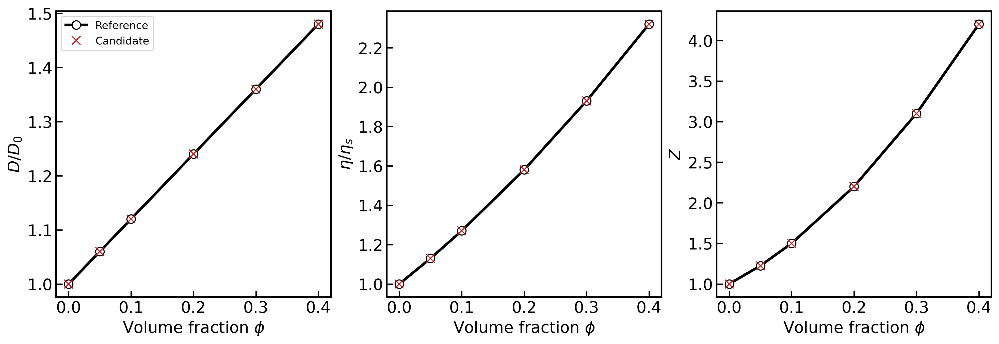

## Physical-quantity comparison {#physical-quantity-comparison}

The personal monochrome preset sets the figure style. Black open circles show the reference and red crosses show the candidate.

[Numerical CSV](data/comparison.csv) / [Figure PDF](figures/comparison.pdf)

| Reduced quantity | Maximum absolute difference | Tolerance |
|---|---:|---:|
| $D/D_0$ | 0.000e+00 | 1.0e-14 |
| $\eta/\eta_s$ | 0.000e+00 | 1.0e-14 |
| $Z$ | 2.220e-16 | 1.0e-14 |
