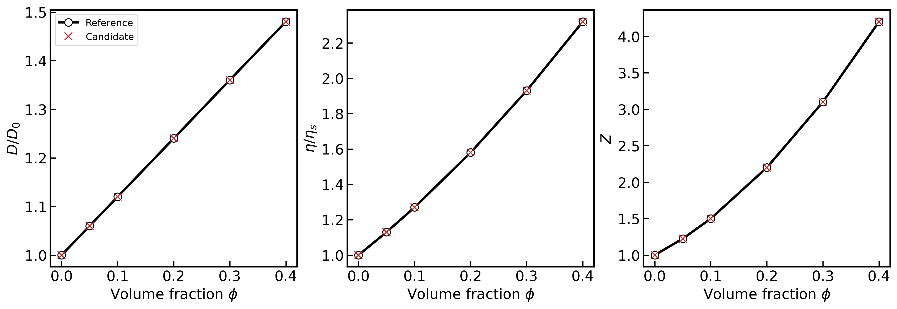

## What this collection provides {#collection}

Copy a reusable scientific template and its declared inputs, tests and license.

- **Modernization** connects bounded scientific capabilities so that models can be verified independently.
- **Plot styles and CSV I/O** help inspect outputs with a reproducible figure style and explicit data columns.
- **Documentation** uses the same Markdown inputs for a detailed report and a short presentation.

[Read the detailed guide](report.html#using-wb-templates)

## Compare the three observables {#observables}

{width=95%}

[Report and numerical table](report.html#physical-quantity-comparison) / [CSV](data/comparison.csv)

## Review a source-code change {#source-change}

```diff
-    viscosity = 1.0 + 2.5 * phi + 2.0 * phi ** 2
+    viscosity = 1.0 + phi * (2.5 + 2.0 * phi)
```

The synthetic example compares six concentrations and all three reduced
quantities with a declared absolute tolerance of $10^{-14}$.

[Full diff and method](report.html#source-code-comparison)

## Edit the source {#edit-the-source}

- **Slides:** edit `slides.qmd`. Find the slide by its heading.
- **Report:** edit `report.qmd` for chapter order or edit the relevant
  Markdown chapter for the text.
- **Figures and data:** edit the input models or `tools/make_example.py`
  and regenerate the comparison assets.

From the template folder, choose a fresh build destination.

```sh
sh render.sh /tmp/wb-comparison-updated
```


