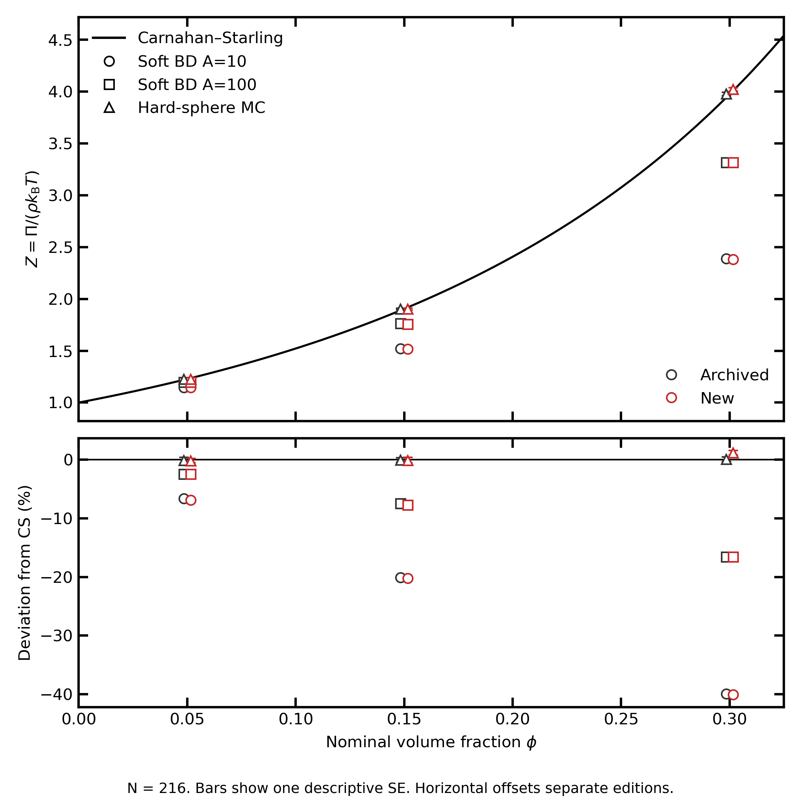

# Equilibrium osmotic pressure of soft and hard spheres

[AI-generated text](#ai-assistance)

Compare the dimensionless osmotic pressure $Z=\Pi/(\rho k_\mathrm{B}T)$ from
soft-repulsive Brownian dynamics (BD) and hard-sphere Monte Carlo (MC) with
the Carnahan–Starling (CS) hard-sphere equation of state. The plot and its
18-point source table are from the retained 2026-11-25 comparison.
[CSV](equation_of_state.csv) | [PDF](equation_of_state.pdf) | [PNG](equation_of_state.png)

## Read the results

Select `edition=new` for the 2026-11-25 results below or `edition=archive` for
the 2026-11-13 main groups. Compare `Z` and `CS_Z` at the same nominal volume
fraction `phi`. `deviation_CS_percent` is $100(Z/Z_\mathrm{CS}-1)$ and
`pressure_reduced` is $\Pi\sigma^3/(k_\mathrm{B}T)=6\phi Z/\pi$.
`Z_SE` and `pressure_SE` give one descriptive standard error in their
respective units. `N` counts particles in each replica and `replicas` counts
independent runs in the group.

| $\phi$ | Soft BD $A/k_\mathrm{B}T=10$ | Soft BD $A/k_\mathrm{B}T=100$ | Hard-sphere MC | Carnahan–Starling |
|---|---|---|---|---|
| 0.05 | 1.143273 ± 0.002576 | 1.196891 ± 0.003046 | 1.225600 ± 0.004099 | 1.227438 |
| 0.15 | 1.518296 ± 0.005759 | 1.756148 ± 0.003916 | 1.901679 ± 0.009249 | 1.903725 |
| 0.30 | 2.381862 ± 0.003862 | 3.314292 ± 0.006382 | 4.021022 ± 0.016423 | 3.973761 |

Increasing the finite repulsion raised $Z$ and moved the soft results toward CS
at all three concentrations. At $\phi=0.30$, the soft results were 40.06% and
16.60% below CS for the two amplitudes. The hard-sphere MC result at the same
concentration was 1.19% above CS.

## Matched conditions and estimators

The main groups used $N=216$ in periodic cubic boxes with nominal volume
fraction $\phi=\pi N\sigma^3/(6V)$. Here $\sigma$ is the soft cutoff or hard
diameter and $\rho=N/V$ is the particle number density. The CS reference is
$Z_\mathrm{CS}=(1+\phi+\phi^2-\phi^3)/(1-\phi)^3$ at the same nominal $\phi$.
[Carnahan and Starling (1969)](https://doi.org/10.1063/1.1672048)

- **Soft BD.** LAMMPS 22 Jul 2025 Update 4 used the cosine potential
  $U(r)=A[1+\cos(\pi r/\sigma)]$ inside the cutoff and zero beyond it. Pressure
  combines the ideal term and the pair virial. Three independent replicas per
  amplitude and concentration used timestep $10^{-5}\tau_\sigma$, discarded
  $2\tau_\sigma$ and sampled $8\tau_\sigma$ at intervals of $0.002\tau_\sigma$,
  where $\tau_\sigma=\sigma^2/D_0$ and $D_0$ is the bare diffusivity.
- **Hard-sphere MC.** The C11 sampler accepts symmetric displacement trials
  only when they preserve excluded volume. Its sweep counts $N$ trials.
  Four independent replicas per concentration used proposal half-width
  $0.15\sigma$, discarded 10,000 sweeps and sampled 100,000 sweeps every five
  sweeps. The pressure estimator is $Z_x=1-\ln(p)/x$ with $x=0.25$ and
  compression survival probability $p$ measured at $V'=V\exp(-x/N)$. This
  gives a finite-compression average of $Z$ over a narrow density interval.

The error bars use the larger of the replica-based and pooled-block standard
errors. For BD the block widths are 0.5, 1 and 2 Brownian times. For MC the
block widths are 500, 1000 and 2000 sweeps for the later runs and 500, 1000 and
5000 for the archive. MC block errors propagate through the log-survival
estimator. These descriptive bars quantify sampling variation. Equilibration,
timestep, particle number and finite-compression bias are separate limitations.

## Particle-number coverage

The 2026-11-25 comparison used only $N=216$. The earlier study ran one
$N=512$ control per model at $\phi=0.30$. For soft BD at $A/k_\mathrm{B}T=100$
with three replicas, $Z$ changed from 3.315584 to 3.325197. For hard-sphere MC
with four replicas and the same proposal width, $Z$ changed from 3.976648 to
3.999224. These controls cover one state per model and sit outside the plotted
main groups. Finite-size scaling and extrapolation to the thermodynamic limit
remain unresolved. This example uses existing runs.

[Equilibrium EOS methods and sampler](../../wb-bd-mc/docs/EQUILIBRIUM_EOS.org) |
[DejaVu Sans notice for the embedded PDF font subsets](../../documentation/examples/quarto-comparison/THIRD_PARTY_NOTICES.md#dejavu-sans)

## Author and project information

**Author and Project Director:** Gunwoo Park.

Project overview: <https://github.com/gwpark-git/agentic-workbench-knowledge>  
wb-templates repository (planned): <https://github.com/gwpark-git/wb-templates>

### AI assistance

OpenAI Codex assisted with documenting this example under Gunwoo Park's
direction. The accompanying CSV and figures preserve the recorded scientific
results.
