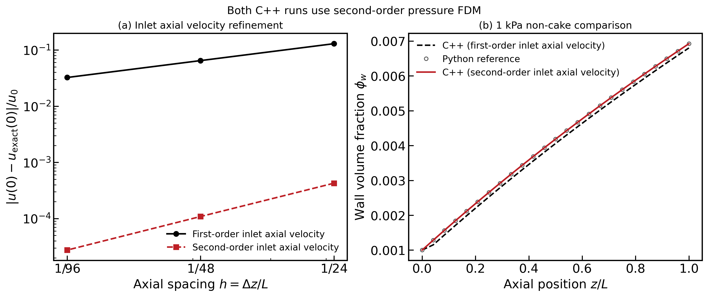

#+title: Second-order inlet axial velocity reconstruction
#+date: 2026-11-26
#+language: en

[[file:../../README.md::#ai-assistance][AI-generated text]]

* Pressure discretization and inlet axial velocity

Both C++ editions use a second-order finite-difference method (FDM) for
the axial pressure equation. With a prescribed inlet pressure, the solver
reconstructs the inlet axial velocity factor from the solved pressure
gradient. The historical reconstruction uses a first-order forward
difference. The current default uses a three-point second-order forward
difference.

Let \(x=z/L\), \(p=P/\Delta P_L\) and \(h=\Delta z/L\).
For a prescribed inlet pressure, the reduced inlet axial velocity is
\(u(0)/u_0=-p'(0)\). The current reconstruction evaluates
\[
\frac{u(0)}{u_0} \approx \frac{3p_0-4p_1+p_2}{2h}.
\]
The implementation weights adjacent pressure differences to cancel the
absolute pressure offset before applying the weights. The pressure
equation retains its existing boundary rows. Interior velocity uses the
centered difference and outlet velocity uses the three-point backward
difference. With =inlet_BC= set to =velocity=, the prescribed inlet value
is used directly as \(u(0)/u_0=1\).

The root C++ template and Levels 1–2 use this default. Level 3 uses the
Level 2 solver. Set =inlet_velocity_order=1= in a pressure-inlet input
to replay historical results based on \(-(p_1-p_0)/h\). The default is
=inlet_velocity_order=2=.

* Verification

The closed-form check solves the clean constant-permeability pressure
problem with zero osmotic forcing, \(k=0.4\), \(P_{\mathrm{in}}=101455\) Pa,
\(P_{\mathrm{out}}=101325\) Pa and \(P_{\mathrm{perm}}=96400\) Pa. The exact reduced
inlet velocity is 4.0437682. The absolute reduced inlet error for 25, 49
and 97 axial nodes is \(1.2950\times10^{-1}\), \(6.4778\times10^{-2}\)
and \(3.2396\times10^{-2}\) with the first-order inlet axial velocity
stencil. The revised errors are \(4.2598\times10^{-4}\), \(1.0874\times10^{-4}\) and
\(2.7466\times10^{-5}\). The observed orders for the revised inlet axial
velocity reconstruction are 1.970 and 1.985.
The unit suite also checks the signed truncation error on a manufactured
cubic, the exactly prescribed velocity and the legacy replay.

A separate non-cake C++–Python comparison uses a nominal TMP of 1 kPa,
25 × 120 nodes, a 10 nm sphere radius and the same logarithmic radial
grid. The Python solver calculates its pressure gradient from the
semi-analytic expression. Maximum relative differences are over the
stored axial domain \(0\le z/L\le1\).

| Observable | C++ with first-order inlet axial velocity vs Python | C++ with second-order inlet axial velocity vs Python |
|------------+----------------------------------------------------+-----------------------------------------------------|
| Wall volume fraction \(\phi_w\) | 10.4522% | 0.06007% |
| Axial velocity factor | 0.33595% | 0.001539% |
| Wall permeate velocity | 0.013404% | 0.0001095% |

With the native Python grid, the wall-concentration difference decreases
from 10.5270% to 0.33013%. The revised run meets the existing 1% allowance
for all three observables on both grids. The maximum absolute pressure
difference on the common grid is 0.04948 Pa at reported precision.

Both C++ series in the figure use second-order pressure FDM. The order
shown in the legends applies to the inlet axial velocity reconstruction.

[[file:inlet-velocity.pdf][Figure PDF]] /
 /
[[file:inlet-velocity-refinement.csv][Refinement data]] /
[[file:inlet-velocity-wall.csv][Wall profile data]]

The root and Levels 1–2 pass their unit, regression and I/O checks.
The three frozen outputs replay with first-order inlet axial velocity
reconstruction. Level 3 reproduces the Level 2 built-in unity closure
byte-for-byte on its axial, integral and outlet tables with second-order
inlet axial velocity reconstruction.

** Grid and cake diagnostics

These SPHS cases prescribe inlet pressure and use second-order pressure
FDM in both editions. The flux deviation is the maximum absolute
percentage departure from the inlet in the printed particle-flux column. Cake onset is the first stored station with positive
cake resistance.

| Nominal TMP and grid | Current stopping status | Current first cake \(z/L\) | Peak flux deviation with first-order inlet axial velocity | Peak flux deviation with second-order inlet axial velocity |
|----------------------+-------------------------+------------------------------+---------------------------------------------------------+----------------------------------------------------------|
| 5 kPa, 25 × 120 | 2,400-iteration limit | — | 0% | 1.109% |
| 5 kPa, 49 × 240 | Converged | — | — | 0% at printed precision |
| 10 kPa, 25 × 120 | Converged | 0.04167 | 0.07895% | 0.03169% |
| 20 kPa, 25 × 120 | Converged | 0.125 | 23.52% | 31.34% |

The 49 × 240 case in
[[file:../modern-lv2/examples/pressure-inlet.inp][pressure-inlet.inp]]
meets the same 5 kPa tolerances and gives a mean permeate velocity of
\(2.805668\times10^{-6}\) m/s. This result is for one resolution.
The solver's stopping status reflects the inherited fixed-point criterion.
Particle conservation and mesh accuracy require their own checks.

The 10 and 20 kPa cases have cake onset at \(z/L<0.5\) and serve as
numerical diagnostics. In the entrance development region, the inlet
flow and membrane wall conditions require matching beyond the approximation
used here. Cake reaching the first axial stations makes that limitation
particularly relevant. Report mean permeate velocity and cake coverage for
extensive-cake cases. For admitted cases, compare all stored axial stations
from \(z/L=0\) to \(1\).

* Published cases

- *JCP 2026.* All eight full CASE1/CASE2 comparisons in the public explorer
  use the prescribed axial velocity at the inlet directly.
  In fresh 200 × 400 replays, CASE1 at nominal TMP 2 kPa and CASE2 at
  0.8 kPa with \(b=1\) reproduced their archived reference-replay axial,
  outlet and integral tables byte-for-byte using the original inputs,
  continuation seeds and tolerances. The separate coarse SPHS 20 kPa
  coverage summary in the viewer uses the historical first-order inlet
  axial velocity reconstruction under prescribed inlet pressure.
  [[https://doi.org/10.1063/5.0336005][Park, Dhont and Nägele, J. Chem. Phys. 164, 244119 (2026)]]
- *JCP 2020.* The paper prescribes inlet and outlet pressures in Eq. (6).
  It reports quantitative agreement between mBLA and independent FEM for
  the published conditions. Fig. 6 compares wall concentration, and Fig. 9
  compares axial and radial velocity profiles at \(z/L=0.5\). The author
  identifies the pressure-driven FDM implementation as the source of the
  numerical velocity in that comparison. The reported agreement provides
  no evidence of a material effect from the mixed pressure and velocity
  orders on the compared observables
  at those conditions. This assessment uses the published comparison and
  the author's account. The exact historical C++ executable and stencil
  remain unidentified, and the current tests cover the revised solver.
  [[https://doi.org/10.1063/5.0020986][Park and Nägele, J. Chem. Phys. 153, 204110 (2020)]]
